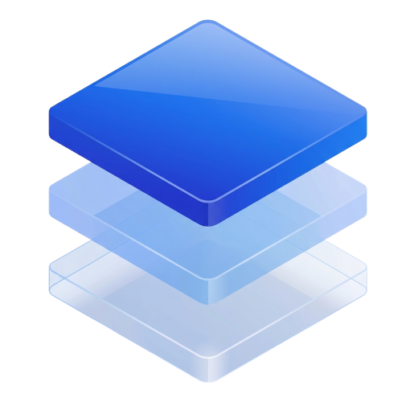

<p align="center">
  
</p>

# AuthRail Sidecar

AuthRail helps organisations control what connected AI agents may do and
understand what happened when they acted. Teams publish rules, review sensitive
requests and connect the resulting records to their policies and compliance
proof.

The **sidecar** is a small program you run beside an application to check those
rules. For example, when an agent asks for a refund, your application uses the
SDK to ask the sidecar whether the request may proceed. The application keeps
the Stripe credential and performs the refund; the sidecar evaluates the rules
and reports its decision to AuthRail. The SDK can also check the returned result
before the agent sees it.

In AuthRail, the rules are called **Rails**. A **deployment** identifies one
installation of your AI system and the Rail versions selected for it. In
**Observe**, the function continues running while you learn how those rules
apply. In **Enforce**, the SDK requires permission before running the function
and checks its result before returning it. Put the SDK around the function
that performs the work, and keep its credentials out of the agent’s reach.

[Documentation](https://docs.authrail.io) ·
[First application](https://docs.authrail.io/docs/getting-started) ·
[Compatibility](https://docs.authrail.io/docs/compatibility)

## Choose a version

The setup executable and native Runtime are released as **0.2.0**. The Node.js,
Go and Python SDKs are **0.1.1**. The quickstart uses these releases with a simple
Policy Rail that compares an invoice ID. Additional integrations described by
current source, including automatic Contextual AI, expanded Guards and Data
reader binding, need versions that support those requirements together. Use the
[compatibility guide](https://docs.authrail.io/docs/compatibility) when choosing
a combination.

The Docker installer currently starts image
`sha256:cb6e60475146ead55bcec56d5da14fcc75e2bf7e776b584b01ace5426a5356f4`
with internal Runtime version **0.1.0**, revision `5547cc5`. That differs from
the separately published `ghcr.io/authrail/authrail-sidecar:0.2.0` tag. Keep the
setup executable version and the running image digest in your deployment notes;
they identify different components.

## AuthRail Contextual AI

The flow in this section is implemented in current source but is not provided
by SDK 0.1.1. Use a compatible released SDK and Runtime before enabling it for
an installed application.

A Rail can use **AuthRail Contextual AI** when it needs to interpret material,
such as whether a code change weakens authentication. Describe the rule on the
Rail, then review the assessment AuthRail prepares: its question, permitted
fields and answer. AuthRail operates the interpretation service, so there is
no model provider to configure in your sidecar.

The SDK obtains the assessment from the sidecar, performs any required local
processing and selects the permitted material. The sidecar relays that signed
request to AuthRail using the deployment credential. AuthRail interprets the
material and returns a signed finding. After verifying that it belongs to the
request, caller, material, phase and Rail version, the sidecar uses the finding
to evaluate the rule. The finding supplies information; the rule still decides
permission.

Review permitted disclosure before publishing because AuthRail receives that
material for transient processing. Normal diagnostics and Actions exclude the
raw material. If the feature is off for the Rail, no contextual request is sent;
if the finding is missing, uncertain or invalid, a rule that needs it cannot
pass. See [Contextual AI](https://docs.authrail.io/docs/facts) for examples and
failure handling.

## How it fits

```text
AuthRail ── signed Rails ──▶ sidecar ◀── local adapter ◀── protected application
                               │                                 │
                               └── decision report ──▶ AuthRail   └── tool/provider
```

The SDK is the **adapter** between your function and the sidecar. It sends
checks at the function boundary, while the sidecar evaluates rules and delivers
decision reports to AuthRail. Choose the [Node SDK](https://github.com/AuthRail/authrail-sdk-node),
the [Go SDK](https://github.com/AuthRail/authrail-sdk-go), or the
[Python SDK](https://github.com/AuthRail/authrail-sdk-python) to connect your
application through the supported adapters. Published SDK **0.1.1** is available
on [npm](https://www.npmjs.com/package/@authrail/sdk-node),
[PyPI](https://pypi.org/project/authrail/) and
[Go package documentation](https://pkg.go.dev/github.com/AuthRail/authrail-sdk-go). Each sidecar runs customer-side for its deployment. Before switching to
Enforce, review other routes to the same tools and credentials so the agent
cannot bypass the function you wrapped.

## Prepare one action

Use [Connect your first application](https://docs.authrail.io/docs/getting-started)
to identify the AI system, describe the function’s input and result, publish a
Rail and select it for an **Observe** deployment. Your account needs permission
to manage those settings. Your installation administrator supplies the workspace
address and the API address used by setup.

The sample invoice read gives you a request and decision to inspect without
changing a provider account. You can then plan the move to Enforce, including
access to the function and its credentials through other tools or routes.

## Download the setup executable

Use the [0.2.0 release](https://github.com/AuthRail/authrail-sidecar/releases/tag/v0.2.0)
for macOS/Linux on amd64/arm64. No Go compiler or source-image build is required.
For example, on an Apple silicon Mac:

```sh
mkdir authrail-sidecar-download &&
cd authrail-sidecar-download &&
curl --fail --location --remote-name https://github.com/AuthRail/authrail-sidecar/releases/download/v0.2.0/authrail-sidecar-0.2.0-darwin-arm64.tar.gz &&
curl --fail --location --remote-name https://github.com/AuthRail/authrail-sidecar/releases/download/v0.2.0/authrail-sidecar-0.2.0-darwin-arm64.tar.gz.sha256 &&
shasum -a 256 -c authrail-sidecar-0.2.0-darwin-arm64.tar.gz.sha256 &&
tar -xzf authrail-sidecar-0.2.0-darwin-arm64.tar.gz &&
cd authrail-sidecar-0.2.0-darwin-arm64 &&
./authrail-sidecar --version
```

The checksum verifies that the archive has not changed. If it fails, stop and
download the archive again from the release page. Choose the archive matching
your operating system and processor; Linux can use `sha256sum -c`. The version
command prints the build information and exits. Full platform commands are in the
[native guide](https://docs.authrail.io/docs/native#1-download-the-sidecar).

## Connect and run

Replace the API placeholder with the address supplied by your installation
administrator, then choose how your application runs:

```sh
export AUTHRAIL_API_URL='YOUR_AUTHRAIL_API_ORIGIN'
# Container application: Docker must be running and the API reachable over HTTPS.
./authrail-sidecar setup --api-url "$AUTHRAIL_API_URL" \
  --directory "$HOME/.local/share/authrail/my-deployment" --runtime docker
```

For an application running directly on the host, use `--runtime native` instead.
It runs in the foreground until Ctrl+C. `--runtime connection` saves the private
connection without starting a sidecar; it is also the default if omitted.

Sign in when the browser opens and choose the organisation and deployment.
Setup creates a signing key locally and registers only its public key. It also
saves a deployment credential, a separate token for local SDK calls and
Node.js/Go/Python helper files beside `integration.json`. Keep this directory
private. If you rerun setup, it preserves the existing key and credentials and
saves updates separately from any helpers you have edited.

Docker setup starts its pinned published image in a private container with
persistent state and credential volumes. Native setup writes its process log
to `sidecar.log` and keeps state in `native-state` under the private directory.
Wait for setup to report usable signed rules, then connect the application
and run its first request.

Wrap the business function with the SDK. Your application supplies the caller
from its login or service authentication, looks up the target record and
chooses a stable key for the business request. Keep provider credentials and
the private application key behind that executor, outside agent access. A host
application uses the native sidecar at `http://127.0.0.1:7078`. A Docker application
must join the sidecar's network namespace printed by setup; an unrelated
container's loopback points at itself. Never publish the decision port or put
the agent in that namespace. See the complete
[Docker guide](https://docs.authrail.io/docs/docker) for placement.

### Stop, restart and preserve state

Pause the protected application before stopping its sidecar. For Docker:

```sh
./authrail-sidecar installation status --directory "$HOME/.local/share/authrail/my-deployment"
./authrail-sidecar installation stop --directory "$HOME/.local/share/authrail/my-deployment"
./authrail-sidecar installation start --directory "$HOME/.local/share/authrail/my-deployment"
```

`installation remove` removes only that container and retains both volumes and
private files. Native installations stop with Ctrl+C; restart with:

```sh
./authrail-sidecar installation run --directory "$HOME/.local/share/authrail/my-deployment"
```

Preserve the whole installation directory and volumes through upgrades. They
contain keys, queued reports and recovery information. Replacing that storage
with a blank or older copy could lose reports or roll back configuration
history. [Recovery](https://docs.authrail.io/docs/recovery) explains how to
resolve pending reports and uncertain effects before removing storage.

<details>
<summary>Build source when contributing</summary>

Use Git and Go 1.26 or newer for a native source build:

```sh
git clone https://github.com/AuthRail/authrail-sidecar.git
cd authrail-sidecar
go build -o authrail-sidecar ./cmd/authrail-sidecar
```

For an operator-managed source Docker image, use the repository
[Docker recipe](docker/README.md). These are source workflows, separate from
the published guided setup above. Pin exact revisions and verify the complete
adapter/Runtime combination; a source build is not a package release.

</details>

## Configuration reference

An operator using an existing deployment tool can supply the settings below
to the Runtime process. Guided setup creates its own configuration; additional
shell variables are not automatically forwarded into its process or container.

| Variable | Purpose |
| --- | --- |
| `AUTHRAIL_CONTROL_PLANE_URL` | AuthRail API address. |
| `AUTHRAIL_DEPLOYMENT_TOKEN` | Credential for the selected deployment. |
| `AUTHRAIL_ORGANISATION_ID` | Organisation ID. |
| `AUTHRAIL_DEPLOYMENT_ID` | Deployment ID. |
| `AUTHRAIL_TRUSTED_KEY_SHA256` | Trusted signing-key fingerprint obtained through setup, not from a downloaded bundle. |
| `AUTHRAIL_STATE_FILE` | Private persistent state-file path, unique per instance. |
| `AUTHRAIL_ADAPTER_TOKEN` | Separate local adapter token for `/evaluate`. |
| `AUTHRAIL_EXECUTOR_PUBLIC_KEY_FILE` | PEM public key of the protected application. |
| `AUTHRAIL_OPERATOR_TOKEN` | Optional separate token to enable local recording-gap review. |
| `AUTHRAIL_OTLP_ENDPOINT` | Optional OTLP/HTTP Collector base URL, for example `http://127.0.0.1:4318`. Use HTTPS for a remote Collector; omit it to disable export. |

`AUTHRAIL_PREVIOUS_EXECUTOR_PUBLIC_KEY_FILE` accepts the previous application
public key during a bounded rotation overlap. `AUTHRAIL_HEALTH_ADDR` changes
the loopback listener from `127.0.0.1:7078`; `AUTHRAIL_SYNC_INTERVAL` changes
the five-second Rail sync interval. Keep the listener on loopback.

The sidecar checks the signed bundle's organisation, deployment, sequence,
activation time, expiry, and signature before using it. An invalid private
state file stops startup rather than resetting rollback protection.

Before an upgrade, pause the protected application and stop the sidecar under
your change procedure. Preserve `AUTHRAIL_STATE_FILE` and its adjacent
`.observations`, recording-gap and trajectory files together. The new binary
should use the same deployment, trusted key fingerprints, adapter token and
public application key. Check `/health` for the expected configuration sequence,
valid rules, queue counts and key fingerprints before accepting requests again.

For rollback, replace the binary while keeping the latest state. An older
snapshot could erase queued reports or allow an earlier configuration sequence.
If the previous binary cannot read the current state, leave Enforce stopped
while resolving compatibility rather than creating a blank installation.
Package smoke checks exercise isolated restarts and sequence protection;
check the running application after carrying out its own upgrade.

## Connect your application

Place the SDK wrapper around the function that performs the work. It sends a
signed `tool_call` before the function and a `tool_result` after a successful
return, using the same business action key for both phases. The SDK handles
request formatting and signing for local `POST http://127.0.0.1:7078/evaluate`,
using the adapter token to authenticate the connection.

Your application authenticates the caller and finds the target record before
supplying those details to the SDK. The signature shows which application key
supplied them; it does not replace the application’s authentication or prove
that a provider operation succeeded. Required provider facts come from the
protected application’s readers, and Contextual AI uses the separate disclosure
flow described above. The sidecar evaluates this information rather than
performing the business operation itself.

## Follow local logs

Process logs help you diagnose the sidecar without setting up a monitoring
service. Native Runtime 0.2.0 and newer source write structured JSON events to
stderr; the earlier image chosen by Docker setup lacks that event stream.
Native guided setup writes to `sidecar.log` in the private directory. To follow
a Docker container’s process output, use the name printed by setup:

```sh
docker logs --tail 50 --follow YOUR_SIDECAR_CONTAINER
```

The `decision` event shows the call or result phase, mode, outcome and recording
status. If required history could not be checked, `check_unavailable` identifies
that problem. `execution_report` describes what the application reported doing
and whether the report reached AuthRail. A later `report_delivered` means a
queued report arrived; resuming held work remains the application’s job.

`request_completed` records the SDK operation, HTTP status and elapsed time.
Use request, Action and attempt IDs to find related records, while treating an
HTTP success as a transport result rather than business permission. Logs omit
arguments, source text, credentials and provider response bodies.

Your operator chooses how to capture, rotate and keep these logs. Output is
best-effort: slow or failed logging can drop lines, counted by `logDrops` in
health. Durable Actions and report queues remain the record of the work.
Optional OTLP export sends traces and metrics to your Collector independently
of the process log.

## Check health and recording

Use `GET http://127.0.0.1:7078/health` to inspect loaded rules, application-key
fingerprints and queued or blocked reports. The `telemetryFailures` counter
tracks dropped spans and failed monitoring exports in this process; it does
not tell you whether a Collector stored the data. Monitoring failures leave
decisions running, and an invalid exporter configuration disables export.

The sidecar also sends a deployment health signal to AuthRail at startup and
every 30 seconds. These checks show the service’s condition. To establish
coverage, also run requests through the application and verify that the SDK
intercepts them.

For a covered check, `recordingStatus` distinguishes:

- `retained`: AuthRail saved the report and returned Action/certificate IDs.
- `queued`: the private sidecar queue saved it for retry; AuthRail has not
  retained it.
- `unavailable`: neither retention nor local queue durability is established.

If upload fails while local storage is working, the sidecar queues the report.
If the queue is full or unwritable, it records a reporting gap. Observe remains
advisory in either case. Enforce requires AuthRail to save permission and the
execution-start report before running a function, so a local queue alone
cannot authorise it. A result check may still stop output after an effect has
happened. Use the deployment’s health and logs alongside local `/health` when
investigating these states.

For human review, the SDK includes a signed `reviewSummary` with the few facts
a named reviewer needs. The sidecar verifies its signature and forwards the
summary instead of the full call arguments or result. Missing or invalid
review context leaves approval unavailable.

After approval, the SDK requests a short-lived permit through local
`POST /approval-permits/claim`. The sidecar forwards that request using its
private deployment credential, and the server consumes the approval once. If
the claim response is lost, `POST /approval-permits/recover` can retrieve the
same still-valid permit; it cannot issue another one or resume a started
attempt. The SDK provides these flows so application code does not need to
assemble the protocol.

Before invoking the provider, the SDK sends a signed `started` report through
`POST /execution-receipts` and waits for AuthRail to acknowledge that it saved
it. Completion and reconciliation reports use the same endpoint. A permit says
that the work may proceed; the application still performs the operation and
reports its outcome.

If that outcome becomes uncertain, use the original provider idempotency key
to investigate the provider’s record. Reconcile the Action only after establishing
success or no effect. A confirmed no-effect reconciliation can allow a fresh
decision and another attempt under the Action, using the same business arguments
and provider key. Facts and session history can be refreshed, and the new
decision may require another approval. The sidecar forwards the application’s
report; it does not independently verify the provider or retry the operation.

## Recover recording gaps

During application-key rotation, keep the old public key available only while
old reports drain. Check `pendingReports: 0` and `blockedReports: 0` on each
instance before retiring it. A revoked key cannot be used to certify queued
reports. An operator can inspect blocked-report metadata through the token-protected
`/observations/gaps` endpoint. After investigating a gap, they can acknowledge
it locally with a reason. This keeps the explanation without creating an
Action or certificate for a report AuthRail never received. Preserve the queue
and session ledger while investigating rather than clearing them to remove
a health warning.

## Project guides

- [Architecture](ARCHITECTURE.md): trust boundaries, decision protocol, local
  state, queue, and recovery invariants.
- [Local protocol](PROTOCOL.md): raw HTTP shape, signed phases, effect receipts,
  conformance, and coverage review.
- [Compatibility](COMPATIBILITY.md): published component versions, protocol and
  state requirements, verification evidence and deployment coverage checks.
- [Contributing](CONTRIBUTING.md): build and test conventions.
- [OpenShell protected executor](integrations/openshell/README.md): customer-owned
  placement and source integration, with separate containment validation requirements.

## Build identity and CI

The sidecar has its own version, separate from the SDK versions. Check a packaged
binary with `./authrail-sidecar --version`, or an image with
`docker run --rm YOUR_IMAGE --version`. The JSON shows its version, source commit,
and configuration, protocol and state format numbers. This command needs no
credentials and does not start the service. A direct `go build` reports
`development` and `unknown`; `scripts/package.sh` and Docker's `VERSION` and
`REVISION` build arguments supply distribution identity.

Sidecar CI checks native builds on Linux and macOS, race tests, signed protocol
compatibility with pinned Node/Go/Python SDKs, and the Docker image. Disposable
container checks cover private networking, restart state and protected SDK
callbacks. These checks use local fixtures, not customer deployments or provider
credentials. The separate Release workflow publishes versioned native archives and images
when its publication option is selected. The published images can be read anonymously; retain the exact reviewed digest.
A released image does not deploy the AuthRail API or establish application coverage.

Maintainers: see [Releasing](RELEASING.md) for checked artifacts and publication setup.
